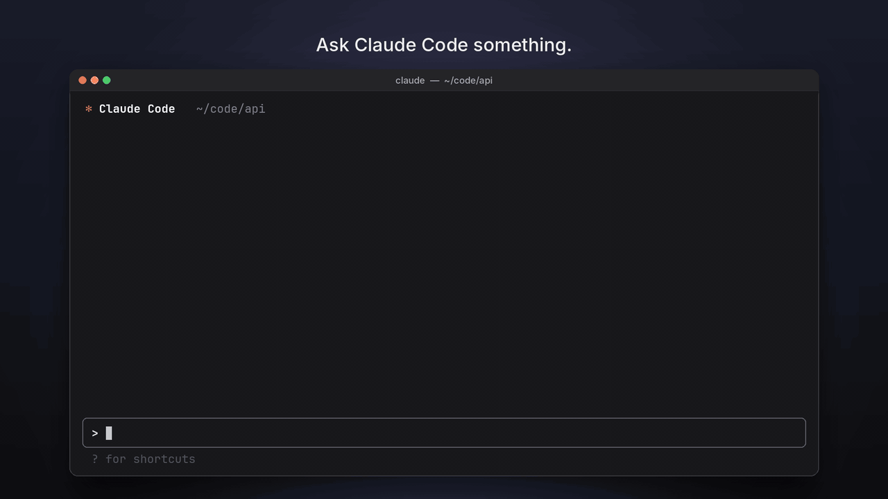

# peer

Get a second answer from the other coding agent, for the same conversation.

In Claude Code, type `/peer` and Codex answers. In Codex, type `$peer` and Claude Code answers. It works in the terminal and in the desktop apps: the Claude Code CLI and the Code tab of the Claude desktop app, and the Codex CLI and Codex in the ChatGPT desktop app. The other tool sees your conversation so far and can read the same files. Its answer comes back into the tool you asked from.



## Install

You need macOS, Python 3.9 or newer, and both Claude Code and Codex installed and signed in. The Codex inside the ChatGPT desktop app works too.

```bash
curl -fsSL https://raw.githubusercontent.com/sajal2692/peer/main/install.sh | bash
```

This downloads peer into `~/.local/share/peer` and links the `peer` command and the `/peer` and `$peer` skills. Run the same command again to update.

Or, to install from a clone you keep yourself:

```bash
git clone https://github.com/sajal2692/peer.git
cd peer
./install.sh
```

To update a clone, run `git pull` in it.

Restart Claude Code and Codex, then check the install with `peer --version`. If the installer says `~/.local/bin` is not on your PATH, the skills still work. To run `peer` from a terminal, add `export PATH="$HOME/.local/bin:$PATH"` to your shell profile.

## Usage

In Claude Code:

| Type | What happens |
|---|---|
| `/peer` | Codex answers your last message on its own, without seeing Claude Code's reply. |
| `/peer review` | Codex reviews Claude Code's last reply. |
| `/peer review error handling` | The same, focused on error handling. |
| `/peer is Redis overkill here?` | Codex answers a new question, with the conversation as context. |

In Codex, use `$peer` in the same ways: `$peer`, `$peer review`, `$peer <question>`.

In a new session with no history, `/peer <question>` or `$peer <question>` is a plain second opinion.

The answer looks like this:

```
## Codex's answer

Model: gpt-5.5 | Effort: high

<Codex's answer>

---
Continue with Codex: codex resume 01a137ed-...
```

Run the `Continue with` command in a terminal to keep talking to the other tool.

### When to use what

| You want | Use | Example |
|---|---|---|
| An independent second answer to what you just asked | `/peer` | You asked Claude Code how to speed up a slow query. `/peer` gets Codex's own answer without it seeing Claude's, so you can compare two fresh takes. |
| A check on the answer you already got | `/peer review` | Claude Code wrote a migration plan. `/peer review data loss` has Codex look for holes in that plan. |
| A side question, with the conversation as background | `/peer <question>` | Mid-way through a refactor, `/peer is there a simpler way to do this?` |
| A quick opinion on something new | `/peer <question>` in a new session | `/peer SQLite or Postgres for a single-user app?` |
| Your tool to weigh in on the other's answer | add `--assess` | `/peer --assess` gets Codex's answer, then Claude Code says where they agree, where they differ and which is better. |
| A stronger or faster model for this one call | add `--model` or `--effort` | `/peer --effort max review` for a careful review of a risky change. |
| A faster answer on a very long session | add `--trim` | `/peer --trim` sends a shortened conversation. |

### Options and settings

Add options after `/peer` or `$peer` for one call:

| Option | Effect |
|---|---|
| `--model <id>`, `--effort <level>` | Pick the other tool's model and reasoning effort. |
| `--assess` | After the answer, your own tool compares the two answers and gives a verdict. (`review` is the reverse: the other tool judges your tool's reply.) |
| `--details` | Show the full run: the exact commands, which message was answered, and how much was sent. |
| `--trim` | Shorten long messages and tool output. By default the whole conversation is sent. |

Or save defaults for every call. Saved settings are shared between both tools:

| Command | Effect |
|---|---|
| `/peer models` | List the models and effort levels you can use. |
| `/peer config` | Show the current settings. |
| `/peer config codex model gpt-5.5` | Use this model whenever Codex answers (`claude model` for Claude Code). |
| `/peer config assess on` | Always add the assessment. `details` and `trim` work the same way. |

See [docs/configuration.md](docs/configuration.md) for every option, the config file and environment variables.

### From a terminal

```bash
peer --to codex "explain the retry logic in client.py"   # a plain question
peer --from claude --last review                       # review the newest Claude Code session here
peer --from codex --session <thread id or path>        # use a specific Codex session
peer --help                                            # every option
```

## Good to know

- **What is sent.** Your messages, the assistant's replies, tool calls and their output, attached files and pasted images. Hidden reasoning and the tools' own setup text are not sent.
- **Sign-in and billing.** peer has no account or API keys of its own. It runs the `codex` and `claude` command-line tools, so each answer uses whatever those tools are signed in with: your ChatGPT plan or an OpenAI API key for Codex, and your Claude subscription or an Anthropic API key for Claude Code. If `OPENAI_API_KEY` or `ANTHROPIC_API_KEY` is set, the tool may bill that key instead. The Claude desktop app signs in separately from the `claude` command-line tool, so for `$peer` run `claude auth login` once with the account you use for Claude Code. Check the sign-ins with `codex login status` and `claude auth status`.
- **Read-only.** The other tool can read files in the folder but cannot change them, run commands outside a read-only sandbox, or use connected apps such as mail or GitHub.
- **Speed.** An answer takes from a few seconds to several minutes, depending on the model, the effort and the length of the conversation. If a very long conversation fails or is slow, try `--trim`.
- **Scope.** Regular ChatGPT and claude.ai chats are not supported, because their history is not stored on your computer.

## License

MIT. See [LICENSE](LICENSE). To work on peer itself, see [CONTRIBUTING.md](CONTRIBUTING.md).
